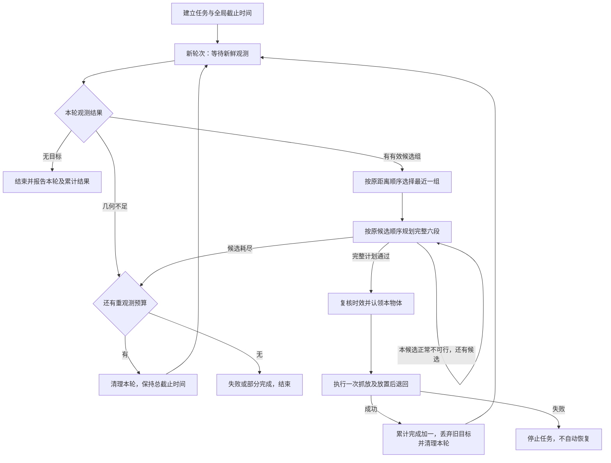

# IMPLEMENT_demo：同碗多候选与逐物体重新观测实施方案

编写日期：2026-09-25。项目目录：`/home/rob/robot_grasp_ws`。

本文件供后续 Codex 实施使用。本轮只生成本文件，没有修改项目业务代码、配置、启动脚本或测试，没有启动 ROS、机械臂、相机或夹爪。以下“新增”“修改”“测试”均为后续工作，不代表已实现或已通过。

## 1. 项目目标与本次范围

目标是在保留 `yolo_vision → rim_locator → grasp_executor → MoveIt` 主框架、现有碗沿壁面算法和最近优先设计的基础上，减少单个抓取姿态规划失败导致整个目标被放弃的情况。

以用户本轮意见为准，覆盖之前分析文档中范围更大的建议：

| 项目 | 本次实施要求 |
| --- | --- |
| 同一只碗多个抓取候选 | 实现；候选必须按物体分组，包含物体编号、候选编号、真实采集时间和几何质量 |
| 物体和抓取候选选择 | 保留当前最近优先设计及原搜索顺序；不新增几何质量、关节行程、限位余量等综合评分排序 |
| 现有 IK 分支排序 | 保留，它已经存在；不要因“不增加新评分”而删除现有 IK 行程排序 |
| 预抓取点 | 固定沿 `base_link` 的 Z 方向高出抓取点 `0.10 m`；不做动态距离搜索 |
| 抓后抬升 | 当前复用预抓取点，本次随之变为高出抓取点 `0.10 m`；不新增独立抬升策略 |
| 每只物体之后 | 完成抓取、放置、释放及放置后退回后，重新观测，再选择和规划下一只 |
| 恢复一 | 尚未开始本只物体的真实运动时，候选规划明确不可行，自动换同物体下一个候选 |
| 恢复二 | 候选全部不可行或感知几何不足，有限次获取新观测 |
| 执行中失败 | 保留停止和错误上报；因为我现在没有反馈，暂时先不设计这块 |
| 整体碗沿圆/椭圆模型、多帧融合 | 不实现 |
| 夹持/抬升/放置结果验证 | 不实现；继续诚实输出 `grasp_verified=false`、`placement_verified=false` |
| 其他抓放策略 | 不改变固定放置点、20 cm 放置下降、停留、释放及退回顺序；不新增自动堆叠、占用管理、底座移动或观察位运动 |

本次不要求新增抓取与放置之间的全局 IK 回溯搜索。继续使用现有分段规划及分支尝试，要求选中候选的完整六段全部通过，再允许执行；某候选放置段规划失败时，可以换另一个接触候选。

“提高抓取成功率”是预期效果。本次验收首先证明多候选、逐物体新观测和有限恢复的行为正确，不宣称达到 100% 实物抓取成功率。

## 2. 当前代码分析与可实现性

下表基于本轮实际读取的源码，行号为编写时位置，实施时以函数名为准。

| 文件 / 函数 | 当前真实行为 | 对实施的影响 |
| --- | --- | --- |
| `src/rim_locator/rim_locator/rim_detection.py:_rim_contacts()`，约 183 行 | 先输出原近侧聚合区域，再按基座水平距离搜索其他观测区域；搜索有数量上限 | 可直接复用多接触区域，不需要新增整体模型 |
| 同文件 `_search_wall()`，约 231–279 行 | 三种尺度检查壁面，两个尺度一致时立即返回首个合格区域 | 改成可收集多个有效结果；保留全部几何门槛 |
| 同文件 `locate_grasp_pose()`，约 282 行 | 每只碗只返回一个 `PoseResult` | 新增列表接口，旧接口继续取首个结果 |
| `src/rim_locator/rim_locator/main.py:finish()`，约 119–181 行 | 按点云 object_id 分物体，每物体一个 Pose；原 PoseArray 按首姿态的水平距离排序 | 新增独立分组消息；不能改变旧 PoseArray 的物体语义 |
| `src/yolo_vision/yolo_vision/main.py:on_pair()`，约 107 行 | 一次同步输入成功后不再接收新任务；每帧重新 enumerate 物体 ID | 不能假设节点已有重观测服务；ID 只在观测内有效 |
| `src/rim_locator/rim_locator/main.py:on_cloud()`，约 64 行 | 只在 `waiting_input` 接收一次输入 | 本期由上层启动下一轮新节点 |
| `src/grasp_executor/grasp_executor/main.py:GraspNode` | 当前支持 point、pose_array；只在 `waiting_target` 接收输入 | 新增明确的候选分组模式；每轮仍保持一次性生命周期 |
| `src/grasp_executor/grasp_executor/grasp.py:build_approach_pose()`，约 46 行 | 固定同 XY、同姿态，Z 加 approach_height | 只修改固定高度，不改工具轴约定 |
| 同文件 `run_batch_task()`，约 371–445 行 | 对冻结 PoseArray 逐只执行，异常会 `cancel.set()`；首次运动前认领整批 | 不能直接用它循环尝试候选；新建单物体候选执行入口 |
| 同文件 `execute_grasp_place()`，约 268–333 行 | 已实现接近、下降、抬升、转移、放置下降、退回六段和夹爪命令；动作异常停止 | 复用，不添加执行后恢复 |
| 同文件 `bounded_call()`，约 157 行 | daemon 线程调用，外层超时不等于内部线程已终止 | 超时不能清 Event 后立即再试候选 |
| 同文件 `claim_target()/claim_batch()` | 原子创建并持久化执行认领；失败保留 | 新入口增加按观测及物体认领，保留原防重复机制 |
| `src/grasp_executor/grasp_executor/moveit_ros.py:_ik_solutions()` | 已有多 seed、软限位、等价角、去重和关节行程排序 | 原样复用，不另造“新增 IK 能力” |
| 同文件 `prepare_plans()`，约 572–621 行 | 两组三段完整通过后才提交计划；真实执行读实测关节，预览可用虚拟终态 | 复用六段检查；补候选失败后的计划失效和截止时间传递 |
| 同文件 `_begin()` | 每段执行前检查关节起点、状态、控制器和场景，之后发 action | 不放宽这些检查 |
| `tools/test_live_place_pipeline.py:main()` | 一次启动三节点；一次观测产生整个冻结批次；任一 failed 直接结束 | 改为执行模式的逐轮编排，并重写计数与结果判定 |
| 三个包各自的 `launch/*.launch.py` | 当前没有 namespace 和观测上下文参数 | 必须增加并透传；仅改 runner 不够 |
| `tools/test_live_place_pipeline.py:on_preview()` | 从全局 `/display_planned_path` 按六段数量计数 | 多轮需专用预览话题，防止跨轮/其他发布者串扰 |
| `src/yolo_vision/yolo_vision/config.py` | 已有原图像素坐标 `inference_roi`、覆盖配置合并 | 可以限定取物区域；没有现成放置区排除或跨帧跟踪 |

可实现性结论：现有算法、规划器和六段执行流程足以支撑本次方案。主要增量是候选数据协议、运动前候选调度、逐轮运行器和新鲜度控制，不需要更换模型或重建主框架。

历史证据仅用于选取回归样本：

- `debug_output/place_execution/20260923_172955/`：检测、定位成功，下降预规划 Cartesian 不完整；适合验证候选接口与失败诊断。当前算法离线检查存在多个壁面合格区域，但不能预先断言其中一定有可执行抓法。
- `debug_output/place_execution/20260923_134903/`：其中一物体搜索 18 个接触区域仍无有效壁面；适合验证几何不足和有界重观测。
- `src/rim_locator/test/data/` 已有真实双碗及深度拖尾夹具，应继续保留。

## 3. 总体实施设计

### 3.1 采用现有一次性节点，由运行器管理轮次

本期不增加常驻触发服务。修改 `tools/test_live_place_pipeline.py`，每一轮启动新的 rim、vision、executor 进程；一轮真实执行最多完成一只物体。



遇到设备、通信、取消、无效起始状态等致命错误，任何阶段均直接结束。图中的循环均受任务总时间、总轮数及无进展次数限制。

### 3.2 保留原物体顺序和候选顺序

必须保留两层顺序：

1. 物体间：按首选抓取姿态到 `base_link` 原点的水平距离，从近到远。定位器仍按原 `(distance, object_id)` 稳定排序；执行/选择侧仍按施加一次 `grasp_offset` 后的首选姿态计算距离，兼容现有非零偏移语义。
2. 物体内：候选 0 必须与原 `locate_grasp_pose()` 的输出一致；其余候选沿当前 `_rim_contacts()` 顺序筛选，稳定去重后保留。原函数先尝试近侧聚合区域，不要为了使所有候选距离严格单调而重新排列候选 0。

先选定最近一只有效物体，再在其候选中尝试；候选失败不会把该物体重新插入远近排序。全部候选失败后先有限重观测；预算耗尽则结束，不增加自动跳过近物体抓更远物体的策略。原本几何无效的物体保留 rejected 记录，若存在其他有效组，沿现有“有效目标近到远”的行为选择。

质量字段仅用于已有门槛检查、诊断、回放；不得参与新综合评分或改变顺序。不得改变 `_ik_solutions()` 内已有的关节解排序。

### 3.3 每次抓放之后全部重新生成目标

真实执行成功的轮次边界为 `execute_grasp_place()` 完成放置释放、退回并返回 success；不能在闭爪、开始抬升或到达放置点时提前开始下一轮。

本轮未执行物体的姿态全部失效，不继续调用旧 `run_batch_task()` 处理它们。下一轮读取新帧并重新定位，规划从当前实测静止关节状态开始。

本期不新增持久物体跟踪器。每轮重新观察整个取物区域并重新选择；不保留跨轮的 YOLO 编号队列。身份使用 `(task_id, observation_id, object_id)`，不能把单独 object_id 当作跨帧身份或已完成黑名单。无进展预算按任务状态计数，不随编号或候选点微小变化重置。

### 3.4 plan-only 与真实执行分开定义

- `run_pipeline_place_execute.sh`：每次成功抓放一只后重新观测，直到明确结束条件。
- `run_pipeline_place_test.sh`：对一次有效观测中的物体组按原近到远顺序预览，各组选择第一个六段完整可行的候选；可以保留已有批次虚拟终态衔接。完成本次快照预览后结束。
- `planned` 不是抓放完成，不能触发“物体已经移走”的新一轮循环。预览中 `completed_count` 始终为 0。
- 预览若在任何物体上耗尽候选，可在未发命令前按同一有限预算重新观测，但必须丢弃整份旧预览批次、从实测起点重新预览新快照，不混合两份观测。
- 候选失败必须回到该物体规划前的虚拟起点；已经通过的前一个物体的虚拟终态可以保留。本轮结束后清空，不能带入新观测。

## 4. 按物体分组的候选接口

### 4.1 新增独立协议，不复用 PoseArray 的物体含义

采用项目现有依赖中的 `std_msgs/msg/String`，承载严格校验、带版本号的 JSON。新增纯标准库协议模块：

`src/rim_locator/rim_locator/candidate_protocol.py`

由定位器、运行器和执行器共用编解码、结构和字段验证。执行器新增 `rim_locator` 运行依赖；这个模块不得导入 ROS、NumPy、视觉推理或定位算法，避免引入运行时耦合和循环依赖。当前 `setup.py` 的 `find_packages()` 会安装该模块，无需新增 ROS IDL/CMake 包。

新定位输出默认 `/rim_locator/grasp_candidates`。新执行模式 `input_mode="candidate_groups"` 只消费指定分组话题，不同时订阅旧 PoseArray。

原 `/rim_locator/grasp_poses` 继续保持每只有效物体一个首选姿态，原 PointStamped / PoseArray 输入模式保留。后续正式抓放 runner 明确使用新模式，不能用消息内容猜测模式。

### 4.2 schema v1

以下为拟新增协议的结构示例，不是当前已有数据或现场坐标配置：

```json
{
  "schema_version": 1,
  "task_id": "session_uuid",
  "observation_id": "session_uuid/round_0001",
  "source_stamp_ns": 1790155800438924032,
  "frame_id": "base_link",
  "tool_frame": "grasp_center",
  "objects": [
    {
      "object_id": 0,
      "distance": 0.41231056,
      "candidates": [
        {
          "candidate_id": 0,
          "position": [0.4, 0.1, 0.2],
          "orientation": [0.0, 1.0, 0.0, 0.0],
          "geometry": {
            "method": "supported_wall_search",
            "wall_count": 50,
            "wall_residual": 0.001,
            "normal_change_deg": 2.0
          }
        }
      ]
    }
  ],
  "rejected": []
}
```

字段契约：

- task/observation 由 runner 创建并通过启动参数传入，三节点状态也带相同上下文。独立节点旧模式允许上下文为空；新连续模式不得为空。
- `source_stamp_ns` 始终是传感器原采集时间，整数纳秒；不能使用节点启动时间或发布时刻代替。
- `frame_id` 指位置和姿态的参考坐标系；`tool_frame` 明确该姿态对应 `grasp_center`。定位器新增显式工具标识参数，仅描述约定，不自行进行未定义的工具变换。
- `distance` 是首选原始姿态的基座水平距离，校验可计算一致性；最终执行顺序仍按施加偏移后的首选姿态复核。
- candidate_id 在物体内从 0 连续编号，object_id 在观测内唯一。只剩一个候选也必须保留组结构。
- geometry 来自真实 `PoseResult.diagnostics`，不编造综合置信度或成功概率。已有 status 的 `candidate_count` 仍表示碗沿点云点数；新增 `grasp_candidate_count` 表示姿态数量。
- objects 只包含非空的有效候选组；无候选物体进入 rejected，携带 object_id、reason、实际几何诊断。同一 object_id 不得同时出现在 objects/rejected。
- 全部定位失败时仍发布 `objects=[]` 和完整 rejected 及时间上下文，以便 runner 区分几何不足与真正无目标。无点云的视觉失败由同轮 vision 状态报告，不等待不会到来的候选消息。

验证须拒绝：未知 schema、缺失关键字段、重复 JSON 键、NaN/Infinity、布尔值冒充整数、重复 ID、空有效组、非有限坐标、非单位四元数、错误 frame/tool、超出数量/大小上限、错轮或不符合采集门槛的数据。建议协议单条消息上限 1 MiB、物体组上限 256、每组硬上限 32；定位器实际输出受 `max_grasp_candidates`（默认 8，最大 32）约束，接收方不信任消息中自行声明的上限。超过限制报错，不静默截断目标。

runner 接收完整观测后，在 execute 模式只把最近一个组转发到本轮私有 `/selected_candidates`，保留原观察身份和时间；executor 必须拒绝 execute 请求中的多个物体组，防止意外恢复冻结整批行为。plan-only 模式允许完整组列表。

候选、selected_candidates 和关联状态沿用现有 `RELIABLE + TRANSIENT_LOCAL, depth=1`。runner 在启动 executor 前建立转发发布器，等待其本轮 `waiting_target` 后发送一次，并保持发布器存活到本轮终态；重复递送由节点状态与认领机制防重。上游先发布、下游稍后订阅也必须可靠获得本轮保留消息。旧消息隔离依赖独立话题和身份检查，不通过改成 volatile 来掩盖问题。

### 4.3 配置与参数

| 位置 | 拟新增或修改项 | 默认/语义 |
| --- | --- | --- |
| RimConfig 和两个 rim JSON | `candidates_topic` | 默认 `/rim_locator/grasp_candidates`；runner 每轮覆盖 |
| 同上 | `tool_frame` | `grasp_center`，与执行器一致 |
| 同上 | `max_grasp_candidates` | 8，正整数且设置合理硬上限，例如 32；不同于现有几何搜索上限 96 |
| 同上 | `candidate_min_separation` | 0.004 m；稳定保留先出现的候选，候选 0 不变；不做质量排序 |
| GraspConfig 和两个 grasp JSON | `approach_height` | 统一由 0.15 改为 0.10；不提供距离列表 |
| GraspConfig | `input_mode` | 在已有 point / pose_array 外增加 candidate_groups |
| `grasp_executor/config/place_config.json` | `input_mode`、`input_topic` | 新抓放采用 candidate_groups / grasp_candidates；runner 覆盖到 selected_candidates |
| GraspConfig | `task_preview_topic` | 默认 `/display_planned_path` 兼容旧模式；新 runner 覆盖为本轮专用话题 |
| 三节点 ROS 运行参数 | `task_id`、`observation_id` | 默认空以兼容旧入口，新 runner 显式设置 |
| vision / executor ROS 运行参数 | `source_not_before_ns` | 默认 0；新轮次传入同一个采集时间门槛，executor 复核输入 |
| executor ROS 运行参数 | `task_deadline_monotonic_ns` | 默认 0 兼容旧入口；新 runner 传入全任务绝对截止时间，启动及每次候选前检查 |
| 三个主 launch | `namespace` 及运行参数透传 | 默认空，旧入口行为保持 |
| runner CLI | `--max-reobservations` | 默认 2，表示无进展时初次观察之外最多两次；允许 0 |
| runner CLI | `--max-observation-rounds` | 默认 30，正整数；全任务硬上限 |
| runner CLI | `--max-completed-objects` | 默认 20，正整数；动作完成次数硬上限，不是视觉检测目标数 |

继续使用现有 `--timeout`（execute 默认 900 s，plan-only 默认 360 s）作为全任务总时限，不能每轮重新获得完整时限。新增数值是初版有界运行参数，不代表可靠性或安全性验证结果。

候选组规划共享外部截止时间：不得给每个候选分别套用完整的 `7 * planning_timeout` 外层预算。可沿用这个现有预算量级作为整组上限，并与任务剩余时间取最小值；`prepare_plans` 每段/每组原有截止时间还要与该共享截止时间取最小值。耗尽总规划时间与“所有候选明确不可行”应分别报告。新 executor 从运行参数 `task_deadline_monotonic_ns` 取得上限；runner 与其启动的本机子进程使用同一 monotonic 时钟基准，不把该值当作 ROS 采集时间。启动耗时也消耗该预算；若截止时间已到，不再规划或执行。

## 5. 约束条件：新鲜观测、区域和日志边界

### 5.1 隔离每一轮的话题与进程

每轮采用唯一 namespace，例如 `/place_demo_<session>/round_0001`。每轮写自己的 effective config，至少把这些绝对话题改为本轮路径：

- vision 的 object_cloud 输出与 rim 输入；
- rim 的 PointStamped、PoseArray、grasp_candidates 输出；
- executor 的 selected_candidates 输入；
- executor 的 task_preview_topic。

仅给节点加 namespace 无法改变配置中已有的绝对话题，必须同时覆盖。`~/status` 和私有 debug 话题随 namespace 隔离；订阅时使用完整限定名。

`/joint_states`、MoveIt 服务、`/execute_trajectory`、控制器服务、TF 以及相机话题保持真实公共资源名称，不能随本轮 namespace 改名。为保留 RViz 可另向全局 display topic 发布已选预览，但 runner 只以本轮专用完整预览和本轮 status 为证据，不再把全局六段消息直接计成本轮成功。

每轮结束后按现有进程组清理方式停止所拥有的子进程，等待退出，销毁订阅/发布器/临时状态，再进入下一轮。清理或停止未确认成功时不能启动下一轮。修改现有 busy 检查：使用完整节点名/namespace 并加入任务级互斥锁，防止不同 namespace 绕过现有单流水线限制；不依赖三个裸节点名判断互斥。

### 5.2 真实采集时间门槛

在上一轮动作全部结束并清理完成后，用同一 ROS 时钟记录 `source_not_before_ns`。下一轮 RGB 与深度/点云采集时间均须严格晚于门槛；旧帧只被忽略，节点继续 ready，不能把旧帧改成新时间。

vision 在 `on_pair()` 进入 processing、解码和推理之前检查门槛；持续旧帧不会重置 wait_started 或总 timeout。保留现有年龄、未来时间、RGB/深度同步检查。

当前深度图模式把 CameraInfo 也放入 ApproximateTimeSynchronizer，并检查其与深度时间差。本次保留这个同步契约；新轮次使用符合现有同步要求的 CameraInfo，不另造接受无时间戳静态 CameraInfo 的兼容模式。RGB/深度是证明本轮新观测的必要时间门槛；CameraInfo 若略早但仍满足既有同步窗口，不能把它误认为旧物体观测。测试同时覆盖正常同步、错误标定时间、旧 RGB/深度三种情况。

所有下游消息仍携带深度/点云原时间；runner 和 executor 再检查 observation_id、source_stamp 及门槛的一致性。ROS 时间用于采集判定，monotonic 用于等待预算；不可混用。时钟回跳或不一致导致无法证明新鲜时终止，不伪造时间继续。

### 5.3 已放物体不得重新进入取物目标

当前默认全视野，没有跨帧已完成物体识别，journal 也不能阻止新观测中再次抓同一实体。因此连续运行需要明确的取物区域，固定放置区必须位于取物区域之外。

本期复用已有 `VisionConfig.inference_roi`（原始图像像素矩形）及 `--vision-config`，不新增区域建模或跟踪系统：

- 现场按实际视野配置取物 ROI；若放置区天然在视野外，允许沿用全视野取物。
- 不从固定放置坐标猜造像素 ROI，不擅自填写未经现场确认的坐标，不修改 YOLO 识别阈值来隐藏已放物体。
- 实施代码可以先完成并用合成/录制数据验收。现场 ROI 或视野关系尚不明确时，将其列为连续实机部署未完成项，不能宣称已解决放置区重复拾取。
- 若现场取物区和放置区无法分离，本方案的连续运行前提不成立；另行设计区域排除机制，不在本次偷偷增加自动跟踪或放置策略。
- 固定落点能否承接多只碗仍按现有现场条件验收；本次不解决落点占用，不保证无人干预堆叠。

### 5.4 每轮保存结果，不覆盖旧证据

输出目录建议：

```text
<output>/
  task_config.json
  result.json
  round_0001/
    effective_vision_config.json
    effective_rim_config.json
    effective_grasp_config.json
    candidates.json
    selected_candidates.json
    candidate_attempts.json
    detection_overlay.png
    base_cloud.npz
    yolo_vision.log
    rim_locator.log
    grasp_executor.log
    result.json
  round_0002/
    ...
```

保留源配置防覆盖检查。三个 effective 配置、运行参数、namespace、门槛和 task/observation 身份都要可追溯；实际 plan_only 值不能只依赖源 JSON 快照，应记录 launch 覆盖后的有效值。

累计结果区分 `initial_detected_count`、每轮 detected/localized/rejected、`observation_count`、`candidate_attempt_count`、`completed_count`、`reobservations_without_progress`。禁止把各轮检测数量相加当作不同实物数量，禁止把候选数量当物体数量。`completed_count` 只在完整真实动作流程 success 后加 1，含义仍为动作完成。

## 6. 详细实施步骤

### 步骤 1：固定范围并建立兼容基线

1. 读取本文件、当前代码和 git 状态，保留用户已有修改；不要从旧 IMPLEMENT 文档复制超出本次范围的功能。
2. 记录现有 point/PoseArray 输入、候选 0、排序、grasp_offset、journal、六段顺序和 plan-only 的行为。
3. 基线测试失败要区分既有问题、环境问题和新增回归，不能为了通过测试降低几何/路径门槛。

### 步骤 2：实现候选列表与共用协议

1. 在 `rim_detection.py` 提取单接触区域的壁面验证与姿态构造，避免复制整套算法。
2. 新增 `locate_grasp_candidates(points, config)`，按原顺序收集合格区域，稳定去重并限额；同一个接触区域的多个拟合尺度不能重复算作多个抓法。
3. 保留现有过滤、壁面点数、跨度、残差、法向一致性、工具倾角、输出范围约束。不新增圆拟合、姿态旋转备选或阈值放宽。
4. `locate_grasp_pose()` 继续返回候选列表的首项；最大输出数量为 1 时与原行为一致。
5. 新建 `candidate_protocol.py` 及协议测试；显式拒绝不合法和超大消息。
6. 定位器按物体发布新候选组，继续发布旧首选 PoseArray；全部几何拒绝也发布新协议及上下文。

### 步骤 3：固定 10 cm，保留其他运动参数

1. 修改 `GraspConfig.approach_height`、`config/config.json`、`config/place_config.json` 为 0.10。
2. `build_approach_pose()` 仍然只做基座 Z 正方向偏移，姿态和 XY 不变。
3. `apply_grasp_offset()` 仍只沿配置规定的 base XYZ 应用一次，不修改 tool0/grasp_center 变换。
4. 抓后 lift 仍返回同一个 approach，因而也是 10 cm。放置下降保持 0.20 m，放置姿态、速度、超时、夹爪时序等保持原值，除非本文件另有明确的预算传播要求。

### 步骤 4：增加规划拒绝类型和计划失效能力

1. 在执行器新增明确的 `CandidatePlanRejected` 或等价结构化结果，字段至少含 stage、reason、object_id、candidate_id；日志保留 Cartesian fraction 和具体子段。
2. 在 MoveIt 抛错点区分候选不可行与运行环境异常，不对所有 RuntimeError 做无条件重试，也不只检查拼接错误字符串的第一项。
3. 新增 `discard_prepared_plans()` 或等效方法，清空 `plans`、`next_segment` 和本候选状态。仅在没有活动 action 时使用；活动 action 交给原停止流程。
4. 新候选尝试前及失败后执行失效；只有本候选完整六段通过才提交。失败候选不得留下可执行旧计划。
5. 规划共享组/任务 deadline；原 `_pose_plan`、`_linear_plan` 和轨迹校验要求全部保留。
6. 预览处理区分当前物体的起始 preview_state 与候选临时结果，失败时恢复原起点；新轮次清空所有旧预览状态。

### 步骤 5：新增单物体候选执行入口

建议新建 `src/grasp_executor/grasp_executor/candidates.py`，实现 `run_candidate_group_task()`；从 grasp.py 复用已有 Pose、位姿检查、偏移、固定放置解析及 `execute_grasp_place()`。

伪流程：

```text
验证任务/观测/帧/时间/单物体分组
读取当前状态，检查接口就绪，解析原固定放置位
for candidate in 本物体原顺序:
    若取消/任务截止/环境异常：终止
    清空不可执行的旧计划
    对候选施加一次偏移，构建高 0.10 m 的预抓取点
    尝试完整六段规划
    若明确 CandidatePlanRejected：记录原因，继续下一个
    若任意其他异常：终止
    再次检查源时间、当前状态和取消
    若 plan_only：记录选中预览，返回 planned
    原子认领本观测中的本物体
    调用现有 execute_grasp_place 一次
    返回执行结果；无论成功失败都不再试候选
全部候选正常不可行：返回 candidates_exhausted，command_attempted=false
```

禁止 `for candidate: run_batch_task([candidate])`：原函数异常会设置共享 cancel，且有错误的冻结批次认领语义。

### 步骤 6：明确恢复白名单和禁止恢复的边界

| 类别 | 行为 |
| --- | --- |
| 正常服务答复：候选 IK 无解、目标碰撞、规划无路径、Cartesian 不完整、候选轨迹约束/碰撞不通过 | 在未发真实命令前切下一候选 |
| 完整抓取三段可行，但该候选后续放置规划不可行 | 同样切下一接触候选；不先执行抓取三段 |
| `candidates_exhausted` 且所有尝试已返回、command_attempted=false | 由 runner 有限重观测 |
| YOLO `no_valid_depth_for_detected_targets`；rim 全部拒绝且原因属于点数/壁面/拟合几何不足 | 由 runner 有限重观测 |
| 当前起始状态非法、TF/模型/反馈/控制器异常、接口未就绪、服务不可用、未知异常 | 终止；不把环境问题伪装成候选失败 |
| 用户取消、规划期间机器人移动、外层调用超时、仍有未结束 worker | 取消并终止，不清 cancel Event 继续 |
| 任何机械臂/夹爪命令已经尝试，之后发生异常 | 原停止处理，保留认领；不换候选、不重观测再抓 |

正常规划器返回的不可行结果与客户端通信超时必须区分。规划预算耗尽时，只有在内部调用已返回且无残留工作时才能报告纯规划未完成；本期默认结束当前任务，不将其误报为“全部候选已验证不可行”再无限重观测。

`bounded_call()` 超时不能杀线程。后续实施应让底层调用感知截止时间，丢弃迟到返回；超时结束本轮并确认进程退出，不允许旧线程在下一轮异步提交计划。

### 步骤 7：新增按物体认领，保留执行失败记录

新增 `claim_candidate_object()` 或同等函数，使用原子创建及 fsync。键基于本观测身份、源时间、坐标系、object_id；candidate_id、所选 pose、几何质量只进记录，不参与防重键。

- A 规划失败、B 成功只产生一次认领。
- 所有候选失败、几何不足、plan-only、不合法输入不写执行认领。
- 认领在完整规划及最终时效复核后、首个真实命令前。
- 同观测同物体重放、换 candidate_id、换候选顺序不能绕过认领。
- 不能先认领本观测所有物体，也不能删除旧 journal 来实现恢复。
- 已认领后执行失败保留认领，整个任务终止。
- journal 只保证消息/观测级防重，不能宣称能跨新帧识别同一个实体；跨轮重复拾取依赖第 5.3 节的作业区域条件。

### 步骤 8：接入新节点输入模式和轮次身份

1. GraspNode 增加 candidate_groups 订阅和独立 worker 入口；与 point/PoseArray 输入互斥。
2. 新模式 execute 必须只接收一个物体组；plan-only 的多组预览使用单独调度，复用每物体候选选择核心。
3. 对应状态包含 task/observation/object/candidate、阶段、是否尝试真实命令、候选失败列表及累计情况。
4. 旧模式状态和接口尽量兼容；新增字段不能改变 `completed_count` 的既有动作完成含义。
5. 一次性节点结束后仍由 runner 负责关停，不在节点中悄悄把 success/failed 改回 waiting_target。

### 步骤 9：改造 runner 为有限轮次状态机

1. 任务启动建立唯一 session、总 deadline、互斥锁、累计结果。已有配置校验和源文件防覆盖继续保留。
2. 每轮生成独立目录、namespace、话题和运行参数，先建立订阅，再 rim → 等待 ready → vision。
3. 使用本轮状态及候选消息判断结果；0 目标不启动 executor，不启控制器；视觉失败时不要等待 rim 无法产生的输入。
4. 有效候选组按旧顺序排序。execute 只转发最近一组；plan-only 转发一次快照全部组。
5. 真实执行仍在有有效目标后才调用原位置控制准备；后续轮次检查控制器就绪，避免在机器人运动期间切模式。保持现有外部控制与停止保护。
6. 本轮命令全部成功后 completed_count 加 1，无进展计数归零；完成退回、清理进程后才建立下一观测门槛。
7. 候选耗尽或纯几何失败：如果允许重观测，则无进展计数加 1，清理本轮后新观测；不改变总 deadline。
8. 每次进入新轮检查总观察轮数及动作完成上限。达到上限报告具体 stop_reason，不能直接标为所有物体完成。
9. no_targets 仅表示一次有效观测没有检测到目标。若它紧接尚未解决的候选耗尽/几何失败，报告 `stop_reason=remaining_unknown`；没有动作完成且没有本次有效预览结果时为 failed，已有动作完成或 plan-only 已取得部分有效预览时为 partial，不能宣称此前失败物体已经被处理。
10. mixed valid/rejected、每轮候选失败和所有历史拒绝均保留，不用成功物体掩盖其他失败。没有跨帧实体匹配时，不推算“初始 N 个全部已被验证移走”。
11. 每次真实命令异常、子进程异常退出、取消、deadline、清理失败都结束整个任务。只有本文件明确白名单才允许进入下一轮。

结果语义建议：

- `planned`：本次快照所有要求的有效物体组均有完整方案；有被拒绝目标则明确 partial。
- `no_targets`：初次有效观测为空，无动作。
- `completed`：动作轮次正常结束、最后有效观测为空、无已知未解决故障；只表明流程与观测结果，不代表新增实物验证。
- `partial`：已有真实动作完成，或 plan-only 已取得部分有效物体的预览，但仍有失败、被拒绝/不确定目标，或因上限结束。预览结果不增加 completed_count。
- `failed`：没有真实动作完成，也没有可作为部分结果的 plan-only 有效预览，且本轮/任务无法继续。
- 保留 `grasp_verified=false`、`placement_verified=false`，候选尝试不增加 completed_count。

### 步骤 10：同步脚本、文档和离线入口

更新新抓放入口的 help、New_run 的转发说明和 README，明确 execute 每只新观测、plan-only 一次快照。底层 `run_yolo_vision.sh`、`run_rim_locator.sh`、`run_grasp_executor.sh` 已经透传 launch 参数，一般无需改动；不得同时启动一套旧 PoseArray 执行器。

旧 `run_pipeline_test.sh`、`run_pipeline_execute.sh` 和旧点输入流程继续可用。新增候选协议不能让旧入口重复消费目标。涉及默认高度的旧预览相应变为 10 cm。

## 7. 文件修改清单

以下是后续预计修改，不是本轮已经修改。

### 7.1 新增文件

| 文件 | 用途 |
| --- | --- |
| `src/rim_locator/rim_locator/candidate_protocol.py` | 版本化 JSON 协议、纯数据结构、严格编解码与验证 |
| `src/grasp_executor/grasp_executor/candidates.py` | 单物体候选编排、候选尝试结果及分组预览调度 |
| `src/grasp_executor/grasp_executor/planning_errors.py` | 明确的候选规划拒绝类型，避免循环导入和字符串猜测 |
| `tools/place_rounds.py` | 建议提取纯 Python 轮次状态、预算和结果汇总，供 runner 调用并易于离线测试 |
| `src/rim_locator/test/test_candidate_protocol.py` | 协议字段、上下文、分组及非法消息测试 |
| `src/rim_locator/test/test_grasp_candidates.py` | 多候选生成、稳定顺序、去重、门槛与兼容 |
| `src/grasp_executor/test/test_candidate_execution.py` | 候选切换、缓存、认领、异常边界及预览测试 |
| `tools/test_place_rounds.py` | 多轮编排、有限重观测、旧消息隔离、时间和计数测试 |

### 7.2 修改现有源码和配置

| 文件 | 修改内容 |
| --- | --- |
| `src/rim_locator/rim_locator/rim_detection.py` | 收集候选、兼容首候选接口；复用原几何约束 |
| `src/rim_locator/rim_locator/config.py` | 候选话题、工具标识、输出数量、去重间距校验 |
| `src/rim_locator/rim_locator/main.py` | 分组输出、上下文、全拒绝消息和准确状态 |
| `src/rim_locator/config/config.json`、`place_config.json` | 显式新增候选参数 |
| `src/yolo_vision/yolo_vision/main.py` | 新鲜帧门槛和任务/观测运行参数；保留一次性节点 |
| `src/grasp_executor/grasp_executor/config.py` | 10 cm 默认值、新输入模式和任务预览话题校验 |
| `src/grasp_executor/grasp_executor/main.py` | 新输入解析和 worker、上下文状态、明确终态 |
| `src/grasp_executor/grasp_executor/grasp.py` | 复用必要执行工具；新增物体级认领/最小状态字段，不破坏旧入口 |
| `src/grasp_executor/grasp_executor/moveit_ros.py` | 候选拒绝分类、共享 deadline、计划失效、本轮预览输出 |
| `src/grasp_executor/grasp_executor/interfaces.py` | 暴露计划失效/必要预算接口，并同步 FakeInterfaces；不添加夹爪反馈功能 |
| `src/grasp_executor/config/config.json` | 固定高度 0.10，旧 input_mode 继续兼容 |
| `src/grasp_executor/config/place_config.json` | 固定高度 0.10、新抓放分组模式 |
| `src/grasp_executor/package.xml` | 增加共用协议所属 rim_locator 运行依赖 |
| `tools/test_live_place_pipeline.py` | 完整轮次调度、快照、私有候选转发、清理、互斥与新计数 |

无需因本方案修改模型权重、分割算法、机器人 URDF/SRDF、外部夹爪驱动或碰撞模型清理策略。`setup.py` 只有确实新增需安装的数据/入口时才修改；包内 Python 模块已可自动安装。

### 7.3 启动、说明和已有测试

| 文件 | 修改内容 |
| --- | --- |
| `src/yolo_vision/launch/yolo_vision.launch.py` | namespace、task_id、observation_id、source_not_before_ns |
| `src/rim_locator/launch/rim_locator.launch.py` | namespace 和观测上下文 |
| `src/grasp_executor/launch/grasp_executor.launch.py` | namespace、观测上下文、采集门槛及 monotonic 任务截止时间 |
| `run_pipeline_place_execute.sh`、`run_pipeline_place_test.sh` | 新行为帮助说明及参数透传 |
| `run_pipeline_place_offline_test.sh` | 收录新增工具测试，保留隔离 MoveIt 集成 |
| `New_run/README.md`、`docs/README.md` | 入口语义、范围与 ROI 部署前提；转发脚本仅有必要时修改 |
| `src/rim_locator/test/test_supported_contacts.py`、`test_multi_pose.py`、`test_outlier_filter.py` | 原几何门槛和旧接口兼容 |
| `src/yolo_vision/test/test_retry.py`、`test_observation_pipeline.py`、`test_sensor_input.py` | 新鲜度门槛、旧帧等待和观测身份 |
| `src/grasp_executor/test/test_place.py`、`test_grasp.py`、`test_ik_selection.py` | 10 cm、顺序、旧认领、取消和轨迹保护回归 |
| `tools/test_place_runner.py` | 从单批 fake 流程改为可驱动多轮的 fake 事件序列，保留0目标/partial/源配置保护 |
| `tools/test_moveit_grasp.py` | 新分组规划、缓存、候选回退和两轮新起点的隔离集成 |

## 8. 测试方法

本轮未执行下列实现测试。后续完成代码后分层运行，先离线，再隔离集成，再按实际授权进行现场验收。

### 8.1 候选与协议单元测试

- 一只碗多个候选仍为一个物体组；两只碗各有多个候选仍为两个组。
- 新候选 0 与旧 API 的位置、姿态和首个诊断一致；改变质量数字不会改变顺序。
- 验证原近侧优先、剩余搜索顺序和 object_id 稳定 tie-break；非零 grasp_offset 后的物体排序与旧执行器一致。
- 每个候选保持壁面点数、跨度、残差、双尺度法向、倾角等门槛；不能把尺度拟合结果重复计为抓法。
- 0/1/上限个候选、去重边界、搜索96区域上限、缺壁面全部拒绝均有覆盖。
- JSON round-trip、超大数据、重复键、NaN、Infinity、bool冒充int、重复object/candidate ID、错误版本/帧/工具、错误时间均拒绝。
- 全拒绝消息保留采集时间与 rejected，不等同于 no_targets。

### 8.2 假执行接口测试

使用 `test_place.py` 现有 FakeInterfaces/RecordingInterfaces 思路扩展：

- A 不可行、B 可行：A 零运动零开闭爪；B 恰好一套六段动作；completed_count=1。
- A 抓取三段可行但放置失败、B 六段通过：只执行 B，不执行 A 的任何前半段。
- A/B 全失败：零运动、零夹爪、零认领，返回 candidates_exhausted。
- 六个执行段以及开爪/闭爪/释放分别失败：停止、保留认领，不切候选、不触发下一轮。
- 取消、反馈过期、当前起点碰撞、TF错误、接口不可用、未知异常均不进入可恢复分支。
- 外层超时后旧 worker 延迟返回：不得提交旧计划或启动并发候选；取消 Event 不得被清除复用。
- 旧 self.plans 不残留；候选失败后 `_begin()` 不可能执行先前方案。
- A 失败 B 成功仅一条认领；同观测同物体改 candidate_id 仍拒绝重复；未处理物体未被提前认领。
- 10 cm、XY/姿态不变、偏移一次、放置下降20 cm、原六段顺序均验证。
- plan-only 零真实运动及夹爪命令、零认领、completed_count=0；允许必要的只读状态与规划调用；候选失败不污染预览起点。

### 8.3 多轮 runner 测试

使用假的 ROS 消息、时钟和 subprocess，不启动设备：

1. 初次 0 目标，不启动 executor、不准备控制器。
2. 一次观测有 A/B，第一轮仅执行 A；退回后才启动第二轮观测。
3. 第二轮 B 移位且帧内 ID 从1变0，必须使用新坐标；旧 PoseArray 中 B 的坐标没有被执行。
4. 一只碗多候选只产生一次抓放；多轮检测计数不能相加成不同实物数。
5. 默认首次失败加两次重观测后结束；更换 ID、时间戳、微小位姿不能重置无进展计数。
6. 成功完成一只后允许重置无进展计数，但全局时间/轮数/动作次数上限不重置。
7. 旧 retained candidate/status、全局六段 preview、旧 namespace 回调不能推进新轮；本轮候选先发布后订阅仍能送达且最多执行一次，转发 publisher 存活至终态。
8. 门槛前 RGB或深度不推理、不锁processing；一直旧帧仍正常超时；CameraInfo 保留现同步校验。
9. 候选耗尽后新观测仍不足、视觉全无有效深度、rim全拒绝正确触发有限重观测；相机超时/TF失败/进程退出不触发。
10. 执行任何阶段失败都不启动新的执行轮次；SIGINT、timeout、清理失败确保不遗留本任务节点。
11. 取物 ROI 内目标参与识别；放置区域目标不被下一轮选入。测试不依赖帧内ID黑名单。
12. plan-only 只完成一次快照预览，不把静止场景虚拟清空；重观测重建整份预览批次。
13. 每轮图像、点云、日志与配置不覆盖；源配置及传入override不被写回。
14. 同时启动两个不同 namespace 的 runner，只有一个任务获得执行互斥。
15. 达到上限、尚未解决的失败后空观测、mixed valid/rejected，不误报“所有物体已验证抓完”。

### 8.4 离线回放和真实 MoveIt 隔离集成

- 保存点云回放只证明几何候选与顺序；不能用它冒充完整可达或实物夹持验收。
- 延用 `tools/test_moveit_grasp.py` 的随机空闲 DDS domain、localhost、synthetic joints/action 方案；该脚本已有“不启动硬件驱动”的实现。
- 使用确定的合成不可达候选 A 与可规划候选 B，验证只提交 B 完整六段；增加放置段失败用例和取消/缓存用例。
- 模拟第一轮最终关节与第二轮新目标，确认第二轮执行规划从新实测状态开始。
- 保留不可达、碰撞、部分Cartesian、软限位、FK/TF转换、速度和起点变化等既有拒绝测试，不降低完整路径要求。

后续推荐验证入口（本轮未运行）：

```bash
cd /home/rob/robot_grasp_ws
./run_pipeline_place_offline_test.sh
```

该现有脚本会构建三个包、运行单元测试及隔离 MoveIt 测试；实施时须把新增 `tools/test_place_rounds.py` 加入其 pytest 列表。它会连接隔离的模拟 ROS 图，不是现场执行入口。

需要单独排查纯单元测试时，沿现有环境设置来源执行：

```bash
cd /home/rob/robot_grasp_ws
source tools/robot_startup_common.sh
load_robot_environment
source_setup "$ROBOT_WORKSPACE/install/setup.bash"
export PYTHONNOUSERSITE=1
export PYTHONPATH="$ROBOT_WORKSPACE/src/grasp_executor:$ROBOT_WORKSPACE/src/rim_locator:$ROBOT_WORKSPACE/src/yolo_vision:${PYTHONPATH:-}"
"$ROBOT_PYTHON" -m pytest -q src/grasp_executor/test src/rim_locator/test src/yolo_vision/test tools/test_place_runner.py tools/test_place_rounds.py tools/test_pipeline_runner.py
```

新增测试文件在实现前不存在，不能把上述命令当前无法运行解释为已实现失败。构建、Python编译、修改脚本的 `bash -n`、`git diff --check` 也要完成。

### 8.5 现场验收边界

现场先使用原 plan-only 入口检查固定 10 cm 的接近/抬升和完整六段，随后才做真实动作验证。当前用户只授权生成文档，本轮不进行现场动作；后续真机执行需具备对应授权和现场条件。

现场记录至少包括：同碗换候选、两只碗逐只抓放后新观测、第二只位置变化、几何不足有限结束、执行异常不恢复、接收区不被重抓。保留每轮原图、点云、候选、选中项和状态。

本次不新增抓取反馈，因此现场可由观察记录实物效果，但系统字段仍标未自动验证。不得把单元测试/MoveIt模拟通过写成“实机百分之百成功”。

## 9. 验收标准

后续实施完成必须逐条提供证据：

- [ ] 保留三个节点和现有壁面几何算法，无整体碗沿模型、多帧融合或新综合评分。
- [ ] 同一物体多个候选按组传输；旧 PoseArray 仍每物体一个首选姿态，不会重复抓放同碗候选。
- [ ] 候选0与旧方法一致，余候选沿原顺序；物体近到远、原IK排序不变。
- [ ] 默认、普通配置和抓放配置的固定预抓高度均为0.10 m；当前抬升同为0.10 m；放置下降仍0.20 m。
- [ ] 运动前候选不可行自动切换；所选完整六段通过后才发命令。
- [ ] 每次真实抓放和退回完成后重新观测；新一轮不执行旧批次剩余姿态。
- [ ] 新帧时间门槛、task/observation上下文、唯一话题、专用预览和进程清理均通过串扰测试。
- [ ] 候选耗尽/纯几何不足只进行配置次数内重观测；总超时与计数不因轮次重置。
- [ ] 所有执行中失败、取消、设备/通信异常均终止，不增加恢复动作。
- [ ] 认领按观测中的物体而非候选，纯规划失败不认领，执行失败保留。
- [ ] plan-only无动作、无夹爪、无认领，不自动循环清桌；旧入口回归通过。
- [ ] 取物与固定放置区域的分离条件明确且有现场或录制数据证据；未确认时注明连续实机部署尚未验收。
- [ ] 结果按轮次记录，候选不计为物体，反复观测不计为新增实物；拒绝/partial/上限信息不隐藏。
- [ ] 保留 grasp_verified=false / placement_verified=false，不新增或暗示自动夹持确认。
- [ ] 完成所列离线回归、隔离MoveIt及构建检查；未做的现场项明确列出，不编造通过结果。

## 10. 给后续实施者的简短任务说明

按本文件实施：保留当前近到远与候选搜索顺序，为每只碗输出一组可靠候选；运动前按顺序尝试，选中完整六段可行的候选后只执行一次；预抓和复用它的抬升固定10厘米。每完成一次抓放并退回后，废弃旧目标、获取新鲜观测再规划。只实现运动前换候选及候选耗尽/几何不足的有限重观测。不要扩展到整体模型、综合评分、动态预抓距离、抓取反馈或执行后恢复。
