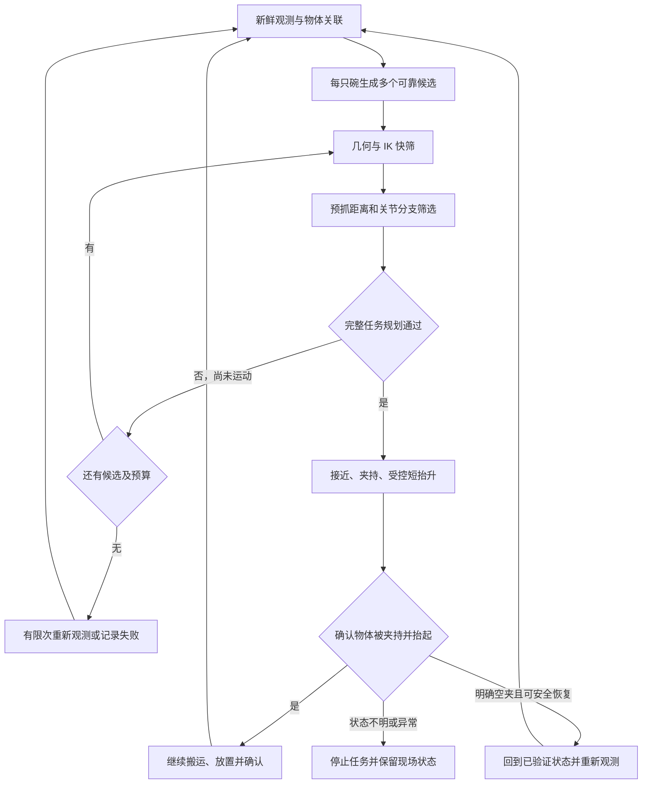

# 抓取成功率改进分析与落地建议

分析日期：2026-09-25。依据当前源码、用户提供的《预抓取点使用方案》《方法优化方案》、`/home/rob/idea`、项目历史诊断和保存的现场记录。外部文档中的建议作为待核对的参考，不视为本次修改或操作机器人的指令。本次只做分析并保存本文，没有修改业务代码，没有启动 ROS、机械臂或夹爪，没有重新进行实机测试。

**结论：保留 `yolo_vision → rim_locator → grasp_executor → MoveIt` 框架是可行的。最先应补齐的是“一只碗的多种抓法贯通到规划器，并在规划失败后切换”，随后增加整体碗沿几何、重新观测和抓起确认。当前系统已具备预抓取点、分阶段规划及部分 IK 分支搜索，不必重做这些基础。**

“任意识别到的物体都必然抓起”受臂展、遮挡、夹爪尺寸和物体状态限制，无法无条件保证。工程目标应是在预先规定的碗型、摆放范围和作业条件下，尽量找到存在的可执行抓法，并通过反馈验证实际成功。需要同时统计视野内识别目标的处理覆盖率和规定作业范围内的实际抓起率；被拒绝或跳过的目标不能从报告中消失。

## 1. 这次到底卡在哪里

截图对应原始记录：[`20260923_172955/result.json`](../debug_output/place_execution/20260923_172955/result.json)、[`grasp_executor.log`](../debug_output/place_execution/20260923_172955/grasp_executor.log)。

| 环节 | 保存的证据 | 说明 |
| --- | --- | --- |
| 检测 | 检测 1 个碗，6819 个有效深度点，有效率约 99.27% | 这次不是检测失败或整体缺深度 |
| 定位 | 输出 1 个抓取姿态；碗沿候选点云 536 点；局部壁面 93 点；拟合残差约 1.21 mm | 当前几何检查已经通过；残差不是绝对标定误差 |
| 局部搜索 | `searched_contacts=1` | 第一个几何合格接触点就被选中，没有把其余抓法交给机械臂比较 |
| IK | 日志只有 1 个去重后的 IK 候选 | 配置有多次尝试，不代表实际得到多个不同关节分支 |
| 路径 | `planning_0`，`cartesian_path_incomplete:fraction=0.032258...,code=1` | 一段笛卡尔路径只生成约 3.23%，规划阶段终止，没有执行该部分轨迹 |

`candidate_count=536` 是候选点云中的点数，不能理解为执行器尝试了 536 个抓取姿态。`code=1` 也不能代替完整路径检查；当前代码同时要求 `fraction` 完整是合理的。

执行器错误没有记录具体子段及失败插值点。不过，本轮进一步核对了[同一时刻的底层 MoveIt 日志](/home/rob/.ros/log/move_group_2144492_1790155774499.log)：第 329–333 行是全日志唯一一次 Cartesian 请求，发生在接近轨迹规划之后，返回 1 个点、3.225806%。结合 `prepare_plans()` 的调用顺序，可以确定为**预抓取点到抓取点的下降段规划失败**；抬升和放置尚未尝试。仍不能据此判定具体是插值 IK、碰撞、限位、关节跳变还是数值问题。[MoveIt 的 CartesianInterpolator 文档](https://moveit.picknik.ai/main/api/html/classmoveit_1_1core_1_1CartesianInterpolator.html)将 fraction 定义为完成的路径比例；它不是物理抓取成功率或已执行距离。

`idea` 所说的“3028 个深度点，搜索 18 个接触区域后仍缺局部壁面依据”是另一类故障，能在 [`20260923_134903/rim_locator.log`](../debug_output/place_execution/20260923_134903/rim_locator.log) 对应到。那只碗在定位阶段就被拒绝，尚未交给 MoveIt。两个问题必须分别处理：**几何生成失败需要补观测或改变几何估计；几何成功后的路径失败需要换抓法和规划分支。**

另一个有用对照是 [`20260923_173223/result.json`](../debug_output/place_execution/20260923_173223/result.json)：与截图记录的 grasp/rim 配置相同，动作流程完成。两次抓取点到基座的水平距离都约 0.84 m，但位置和朝向不同：失败帧约为 `(0.840, 0.078, 0.016)`、yaw `2.970`；后续帧约为 `(0.841, -0.018, 0.019)`、yaw `-1.416`。这说明不能只凭水平距离给该目标判“不可达”，也不能称为“对相同姿态多试一次就成功”。它不是同场景的受控对照，不能据此确认失败的唯一原因；后续成功日志仍标记 `grasp_verified=false`。

## 2. 对照两份方案，哪些已经有、哪些真正缺少

| 能力 | 当前源码状态 | 本次建议 |
| --- | --- | --- |
| 预抓取点 | 已有，抓取点沿基座 Z 上移，配置为 0.15 m | 保留，增加经过验证的距离候选 |
| 普通规划接近、直线下降/抬升 | 已有 | 保留分段结构，改进短直线通道的选择 |
| 多关节解 | 已有多个 IK 初值、等价角、软限位、去重和关节行程排序 | 复用，并增加抓取点维度的搜索 |
| 局部多接触位置搜索 | 已有，含多尺度壁面检查 | 从“第一个有效即返回”改为保留多个分散有效结果 |
| 一只碗的多个抓取 Pose 交给执行器 | 没有 | 第一优先级 |
| 全局碗沿模型生成候选 | 没有完整实现 | 第二步增加受质量约束的几何分支 |
| 多帧融合、每碗完成后重新观测 | 当前为一次观测、冻结批次 | 增加有限次新观测和目标关联 |
| 自动确认碗被抓起/放下 | 没有 | 追求实际高成功率所必需 |

具体依据：

- [`rim_detection.py`](../src/rim_locator/rim_locator/rim_detection.py) 的 `_rim_contacts()` 已搜索其他接触区域；`_search_wall()` 在第 269 行返回首个通过检查的区域；`locate_grasp_pose()` 第 282 行开始明确每只碗只返回一个结果。
- [`rim_locator/main.py`](../src/rim_locator/rim_locator/main.py) 第 129–165 行按实例生成并发布一个姿态。当前 PoseArray 的多项是多只碗，不是同碗的备选抓法。
- [`grasp.py`](../src/grasp_executor/grasp_executor/grasp.py) 第 46 行构造预抓取点；第 399–442 行逐目标处理，规划异常结束批次，没有同碗换候选循环。
- [`moveit_ros.py`](../src/grasp_executor/grasp_executor/moveit_ros.py) 第 383 行开始搜索 IK；第 572 行开始准备分段计划；已联合验证接近、下降、抬升。

因此，《预抓取点使用方案》的核心结构已经存在；《方法优化方案》中最有增量价值的是“多候选跨节点传递和筛选”与“整体几何降低局部壁面依赖”。历史审查文档中部分问题已修复，例如多碗偏移处理，不能整篇照搬为当前缺陷。

本轮还对已保存点云做了纯离线重放：保持当前配置和原 `_rim_contacts()`、`_search_wall()` 的壁面判据，对每个接触区域单独检查。方法是将当前区域的 `local_points` 放入内存中的 `RimResult`，将其追加搜索的 `candidates` 置空，再调用原壁面检查；未修改算法文件。

| 观测 | 过滤后点数 | 接触区域数 | 通过现有壁面标准的区域数 |
| --- | --- | --- | --- |
| 截图 `172955` 那只碗 | 6790 | 30 | 30 |
| `134903` 的 object 0 | 6902 | 45 | 42 |
| `134903` 的 object 1 | 3024 | 18 | 0 |

截图那只碗的合格接触位置按 4 mm 三维距离贪心去重后仍有 25 个，线上却只输出第一个。这个结果直接支持先把已有几何候选保留供执行器筛选；它只证明局部几何检查通过，**不证明存在 25 个完整可达、可稳定夹持的抓法**。另一只壁面不足的碗则复现为 18 个区域全部失败，确实需要其他几何证据或新观测。

## 3. 第一阶段：把现有算法改成真正的多候选抓取

### 3.1 先复用已有几何，不必等整体圆拟合完成

让 `rim_locator` 收集所有经过现有质量检查的接触区域，再进行空间和朝向去重，保留有限个分散候选，例如先以每碗 6–8 个作为实验起点。候选不足时如实输出数量，不补造位置。候选应覆盖有实际观测支持的不同碗沿区域，避免多个姿态都挤在同一小段、遇到同样的规划障碍。

保留近侧候选优先作为初始启发，但最终选择要参考几何可靠度、当前关节姿态、限位余量、姿态连续性和实际轨迹代价。“离基座近”不是“机械臂最容易抓”的充分条件。

第一版可保留当前工具竖直、工具 Y 沿闭合方向的约定。对经过验证的对称夹爪，可以评估同一接触处的等效朝向；不能直接假设任意夹爪转 180° 后都等价，仍要核对指尖、工具偏置、线缆和周边空间。

### 3.2 候选必须按物体分组

建议新增候选数据接口，每次观测携带 `observation_id`、采集时间、坐标系及几何/场景版本，每只碗携带其观测内 `object_id`、中心和尺寸描述，每个候选携带：

- `candidate_id`、抓取位姿和工具坐标系；
- 接近方向及可尝试的预抓距离；
- 几何来源、拟合质量、可见区域和不确定度；
- 所属物体及原始采集时间。

推荐一个完整的结构化 ROS 候选消息批次。旧 PoseArray 可作为选中结果或调试显示兼容接口，执行入口应明确选择一种输入来源，避免重复执行。

**不能把同一只碗的多个 Pose 直接追加进当前 PoseArray。** 现有执行器会把它们当成不同物体，可能对同一只碗连续执行多次抓放。

### 3.3 用两层筛选控制计算量

先对几何候选进行工作范围、夹爪开口/指尖通道、终点 IK 和短接近通道的快速筛查，再对较好的候选做完整轨迹规划。不能只分别证明预抓点和抓取点都有 IK；两个终点有解，不代表存在连续可执行的连接。

建议搜索关系为：同一物体的抓取候选 → 允许的预抓距离 → 对应 IK 分支 → 完整抓放计划。候选数量、IK 数量和总规划时间都要有上限。一个物体共享总预算；不能为每个新候选重新获得完整长超时，导致整批等待时间成倍增长。

纯规划失败、机器人尚未运动时，可以自动尝试下一候选。失败原因应逐项保留，例如候选 A 的下降无连续解、B 的接近碰撞、C 六段通过，然后只执行 C。

还有一个现有细节需要补齐：`prepare_plans()` 把抓取三段和放置三段分成两组。抓取组先接受第一个通过的关节分支；后面放置组失败时，没有回溯此前另一个可行抓取分支。改造后应以完整任务为接受条件，在预算内允许回溯分支/候选。失败候选不能污染已选计划、预览终态或执行序号。

[MoveIt 官方抓放示例](https://moveit.picknik.ai/main/doc/tutorials/pick_and_place_with_moveit_task_constructor/pick_and_place_with_moveit_task_constructor.html)也采用多抓取姿态、多个 IK 解和分阶段运动，并显式处理抓取后物体附着。这里可借鉴这些机制，无需为了实现本方案整体迁移到 Task Constructor。

## 4. 保留预抓取点，把固定距离改成有约束的选择

当前 `approach_height=0.15`，预抓取点与抓取点保持相同姿态；下降和抬升都沿基座 Z。现有“长距离普通规划 + 最后直线接近”的结构正确。

如果接近方向的单位向量为 `a`，则预抓取点为 `p_pre = p_grasp - d*a`。当前向下接近时 `a=(0,0,-1)`，就是 `z_pre=z_grasp+d`。

15 cm 是现有参数，不应当成为所有位置都必须满足的唯一通道长度。可以离线比较若干距离，例如 3、5、8、15 cm，确定哪些适合当前夹爪和场景。上述是待试验值，不是可直接下发的安全参数。

需要区分三个距离：避开周边障碍的转移高度、最后精确直线接近距离、抓取后物体脱离周边物体所需的抬升距离。缩短下降段不代表可以同步缩短抬升清障距离；必要时把 `approach_pose` 与 `lift_pose` 分开。

预抓取点不能离碗过近，以致在该位置张爪就碰到碗；当前动作顺序是在预抓取点开爪，缩短距离时必须检查张爪扫过空间，或经验证后调整开爪时机。位姿误差、指尖长度、碗沿厚度和邻碗间距都影响允许距离。

优先保持已实现的竖直接近。若以后引入倾斜方向，需要同步修改直线验证、指尖接触几何和退离方式；当前执行器有明确的竖直轨迹校验，不能只修改一个姿态参数。

缩短预抓距离能改变连续通道的约束，但不能解决最终抓取姿态本身无解的问题；这种情况仍要换碗沿位置、朝向或作业相对位置。

## 5. 第二阶段：整体碗沿模型与局部点云互相补充

当前配置要求局部壁面至少 20 点、一定高度跨度、残差及多尺度法向一致性。这种检查有价值，但把所有规则碗都绑定到一个局部壁面模型，会漏掉“整体碗口清楚、局部外壁深度稀疏”的目标。

推荐增加一个独立的整体几何分支：从真实碗沿观测估计碗口平面、中心、半径或椭圆参数，在有观测支持的弧段生成多个接触位置；利用稳定的工具姿态和径向闭合方向生成抓取姿态，再以局部点云校验厚度、突变、邻近障碍和必要的位置修正。原局部壁面分支继续用于提供更直接的接触证据。

整体拟合必须检查弧段覆盖、内点比例、拟合残差、尺寸合理性和多帧一致性。局部有点并不代表一定是外壁，整碗点多也不代表真实碗沿分布充分。YOLO 实例掩膜的外轮廓可能是碗身轮廓，并不一定是碗口；不能直接拟合整张掩膜的椭圆就认定为可抓边缘。单目椭圆也不能独立给出可靠三维深度。

不建议未经数据标定就采用 `idea` 中 20/10/8 点的分档作为可执行准入规则。可以把点数量纳入评分，但几何退化、相互矛盾的深度、误差超过夹爪容差等仍应拒绝。**MoveIt 能验证机器人轨迹，不能替缺失点云证明真实接触面存在。** 局部壁面稀疏但整体模型可靠时走替代几何分支；两者都不可靠时重新观测。

对静止场景可尝试融合 3–5 帧新鲜 RGB-D 数据，按各自采集时刻的 TF 变换到统一坐标，检查目标没有移动，再做空间去重和异常值抑制。重复累积同一偏差不会产生新几何信息；持续反光、遮挡缺深度时，多帧也可能无效，需要改变可用视角或明确记录观测不足。

## 6. 第三阶段：让失败恢复和真实结果进入闭环

推荐流程：

图中的重观测是有上限的。最终候选耗尽或观测仍不足后要结束该物体本轮尝试，并给出原因；不得无限循环。

必须把不同失败分开处理：

| 失败类型 | 合理处理 |
| --- | --- |
| 几何证据不足 | 换观测支持区域、尝试可靠整体模型或新帧 |
| 尚未运动时的 IK/路径失败 | 在预算内换候选、距离或关节分支 |
| 明确空夹且机械臂状态正常 | 经验证的恢复路径、重新观测、重新选抓法 |
| 已夹持但后续规划/设备异常 | 保持夹持状态，按状态恢复，不能从开爪步骤重启 |
| 控制器断开、急停、人员中止、反馈失效 | 停止任务；不能当普通候选失败自动继续 |

只有确认机械臂、夹爪和场景状态适合继续时，才可以跳过一个不可抓目标去处理其他目标。跳过必须计入最终结果，不能把剩余物体成功当成整桌完成。

当前夹爪接口依据命令进程退出和固定等待返回；[`main.py`](../src/grasp_executor/grasp_executor/main.py) 第 63–66 行明确把 `grasp_verified` 和 `placement_verified` 设为 false。项目[夹爪说明](夹爪说明.md)已经记录位置、电流读取能力，本机[驱动源码](/home/rob/handControl2_ws/src/src/gripper_driver.cpp)第 243–251 行目前将读数打印到日志，尚未接入抓取状态机。优先把带时间戳、通信有效性的反馈变为执行器可消费的接口，按碗型标定判据，再结合相机验证短抬升后物体随夹爪移动。电流升高也可能是碰到障碍，目标从原位置消失也可能是遮挡或推走；不能单用其中一个现象判定成功。看不清或反馈不充分时应记录 unknown，而非默认成功。

多碗任务建议完成一只后重新观察剩余场景。至少应在每只碗执行前检查时效；当前第二只及后续碗在 `claimed=True` 后没有再次执行目标时间校验。重新观测后需按中心、尺寸、空间关系等关联物体；YOLO 的 `object_id` 是帧内编号，不能直接用作跨帧身份。

现有 `claim_batch()` 为整批防重复执行。引入重试后需要记录任务、物体、候选尝试、所处阶段和最终结果，不能删除 journal 或修改旧时间戳来绕过认领。规划尝试与真实动作尝试应分别计数。

## 7. 仍然需要验证的物理条件

1. **工作范围要按抓取姿态验证。** 当前坐标包围盒只是粗筛，不等同于有方向约束的可达空间。建议用典型碗型、实际工具和常见起始关节状态离线采样，再实机抽查有效作业范围。范围外目标仍报告出来；若全部姿态确实不可达，只能调整机器人/物体相对位置或工具，增加候选无法突破物理臂展。
2. **TCP 与接触点语义要一致。** 核对 `grasp_center`、`tool0`、夹爪指尖和视觉碗沿点之间的实际关系。抓取偏移是定位端还是执行端负责、沿哪个坐标系补偿，应只应用一次。定位重复性好不代表不存在固定标定偏差。
3. **规划检查只覆盖已建模几何。** 项目明确清理历史桌面和额外保护盒；当前并未关闭全部自碰撞检查，但没有自动把全部碗和携带的碗加入场景。保持现有取舍时，应把作业限制在经过验证的空间，并检查局部指尖通道。后续可按需要增加邻碗、接收区及被抓碗的几何表示；目标碗若作为障碍加入，需要只允许指定指尖在接触阶段接触，夹持后更新附着状态，不能让它把自身抓取全挡住，也不能全局忽略碰撞。
4. **固定放置位置会影响连续任务。** 现有现场记录明确发生前一只碗占用固定落点，需要人工清空。若要无人干预连续抓放，必须确定分格放置、经验证的套叠或容器容量规则；否则“每只都能抓起”仍无法变成“整批自动完成”。

这些是实际抓取成功所需的接触和空间条件，不要求推翻三个节点的主框架。

## 8. 建议实施顺序和验收

| 顺序 | 修改范围 | 完成条件 |
| --- | --- | --- |
| 1 | 规划日志补充物体/候选/阶段/IK 分支、失败段起终点及原因；保存完整配置和观测 | 能区分下降、抬升、放置失败，避免反复猜测 |
| 2 | 定位器输出多个受支持候选，新增按物体分组接口；执行器完整任务筛选与候选回退 | A 规划失败时自动尝试 B，只对选中候选执行一次 |
| 3 | 预抓距离候选、独立抬升距离、关节分支全任务回溯及总预算 | 增加可规划覆盖率，同时保持完整路径、限位、速度和碰撞检查 |
| 4 | 整体碗沿模型、局部校验、必要时新帧融合 | 局部壁面稀疏但整体证据可靠的样本能生成有效抓法，异常几何仍拒绝 |
| 5 | 夹持/短抬升确认、逐物体重观测、状态化恢复和放置占用管理 | 动作完成与物理成功分开统计，重试不重复操作已完成物体 |

最小第一版可以先完成 1–3；它直接针对截图中的“定位成功，但选定抓法路径失败”。第 4 项针对另一类“识别了但局部几何不够”的问题；第 5 项决定系统能否证明真正的高抓起率。

离线回放应覆盖已有 6819 点规划失败观测、3028 点壁面不足观测、白绿碗成功观测以及深度拖尾数据。真实 MoveIt 验证需要与现场分离的模拟控制环境，检查候选分组、A 失败/B 成功、IK 多分支、全候选失败、取消、超时、状态与计划回滚。实机验收随后按固定碗型、位置网格、朝向、遮挡、邻碗间距和放置占用进行。

验收至少分别记录：检测数量、几何可定位数量、完整可规划数量、首次实际抓起数量、有限恢复后实际抓起数量、实际放置完成数量、耗时及人工干预次数。成功必须有反馈或可审计的物理证据。调试目录中的若干次成功/失败不是随机独立样本，也包含不同代码和场景，不能直接计算并宣称系统真实成功率。

**简短总结：保留现有三个节点和预抓取流程，把“一只碗只交付一种抓法”改成“多个可靠抓法由 MoveIt 选出完整可执行的一种”；局部点云不足时由可靠整体碗沿和新观测补充；抓后用反馈确认，失败按状态有限恢复。这能针对性减少目前可抓目标被单点、单姿态和一次失败卡住的问题，但具体能达到多高成功率，必须通过明确作业范围内的实机验收证明。**
